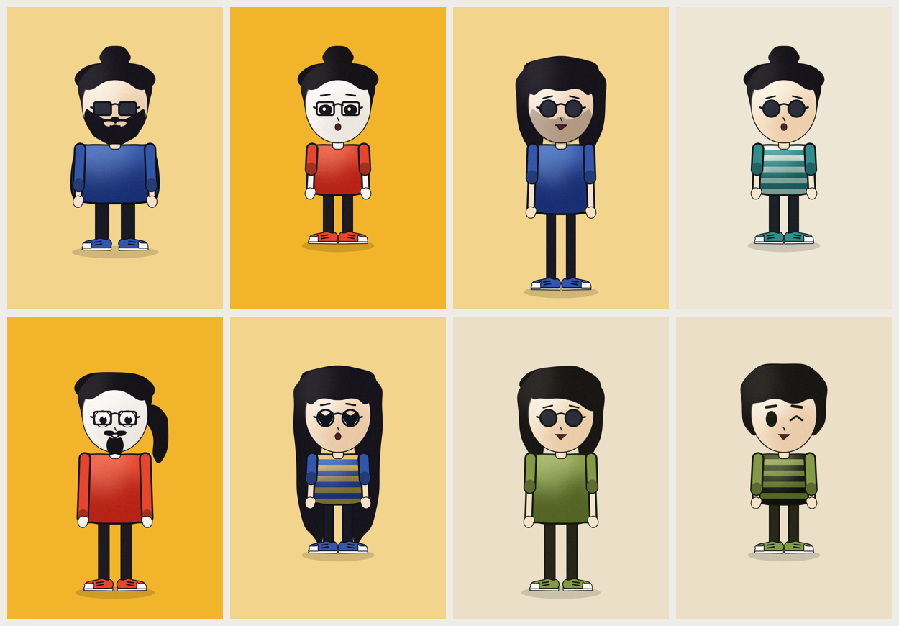

# Character Builder

An After Effects panel that generates fully rigged, ready-to-animate
**rubber-hose characters** — one click, exquisite-corpse style. Every
**Generate** is a surprising new character; cycle any part to dial it in
(that part locks automatically), lock what you love, and reroll the rest.
Then **Rig** it and it's ready to pose and animate.

Characters are drawn entirely from parametric AE shape layers — no
imported art — in a modern flat "rubber-hose" look, with a spray-shade
texture pass, auto-blink, and a breathing idle.

## Install

1. Copy **`dist/CharacterBuilder.jsx`** into your AE scripts folder:
   `…/Adobe After Effects <version>/Scripts/ScriptUI Panels/`
   This single file has the whole engine built in; nothing else needs to
   travel with it.
2. Restart After Effects and open **Window → CharacterBuilder** (it docks
   like any panel).

**Requires After Effects 2023 (23.0) or newer** — the shading uses the
modern `setTrackMatte` API and the limbs use `createPath()` expressions.
Built and tested on AE 2026.

> **Working on the code:** the top-level `CharacterBuilder.jsx` is the
> development version. It loads its engine from the `tools/` folder next
> to it, so run it from inside the repo (File → Scripts → Run Script
> File…). After changing anything, run `python3 tools/build_standalone.py`
> to rebuild `dist/CharacterBuilder.jsx`.

## Using the panel

- **Part rows** — one per slot (Palette, Body, Hair, Eyes, Brows, Mouth,
  Beard, Specs, Top, Sleeve). Use **◀ ▶** to cycle a slot; cycling
  **auto-locks** it (you chose it, so it's kept). Toggle the checkbox to
  lock a random result you like, or release a dialed slot back into the
  shuffle.
- **Generate** — rerolls every *unlocked* slot into your active comp
  (a comp named **Character**). Lock nothing for pure roulette; dial or
  pin a few for exquisite-corpse.
- **Rig** — adds the rubber-hose IK rig: drag the red **hand/foot**
  controllers to bend the limbs, rotate **Hips/Chest** to bend the body,
  **Head** to tilt (pivots at the neck), **Master** to move everyone. All
  art is locked so only the controllers are grabbable.
- **Pose** — a random pose (rigs first if needed).
- **Idle** — a subtle breathing bob; tune or remove it via the **Idle**
  slider on the `CB_Master` controller.
- **Set** — Settings: Grain / Shading / Blink toggles and the Seed
  (for reproducing or sharing an exact character).

## How it works

Three pieces, deliberately separated so art, generation, and rigging
stay independent:

| File | Role |
| --- | --- |
| `tools/character_gen.jsx` | The **generator**. A seeded genome + parts library; `CGEN.buildChoice(comp, choice, opts)` draws a full character. Exposes the slot list the panel builds its rows from. |
| `tools/rigger.jsx` | The **rigger**. `CBRIG.rig/pose/idle(comp)`. Art-agnostic: it rigs *any* comp that follows the layer convention — generated, hand-built in AE, or imported and organized (à la Overlord). |
| `CharacterBuilder.jsx` | The **panel**. Translates the mock into ScriptUI and wires it to the generator and rigger. |

Because the rigger is decoupled from the art, you can **rig your own
characters**: name the layers per `docs/rig-convention.md` (limbs
anchored at the joint, generic art tagged by region) and call
`CBRIG.rig(comp)`.

## Repo layout

- `dist/CharacterBuilder.jsx` — the single-file panel (install this)
- `CharacterBuilder.jsx` — the development panel; `tools/build_standalone.py` builds `dist/` from it
- `tools/character_gen.jsx` — generator (genome + parts + spray-shade)
- `tools/rigger.jsx` — art-agnostic hose-IK rigger (rig / pose / idle)
- `tools/rig_spike.jsx` — the original single hard-coded rig (reference)
- `tools/*_study.jsx`, `tools/hero_striped.jsx`, `tools/character_builder.jsx`
  — design-exploration one-offs kept for reference
- `docs/rig-convention.md` — the layer naming/tagging convention for rigging
- `docs/rigging-notes.md` — hose-IK contract, hierarchy, AE shape-layer facts
- `docs/jsx-design-principles.md` — ScriptUI panel design philosophy & gotchas
- `mock/panel-mock.html` — the clickable panel mock the UI was designed from
- `renders/` — milestone renders · `character-ref-ai/` — style references

## Status

Core tool complete end to end: **generate → rig → pose → animate.**

- ✅ Rig spike — expression IK, bendy `createPath()` limbs, controllers
- ✅ Genome + parts library — seeded shuffle, variants, palettes, texture, locks
- ✅ Panel — mock-first design, then ScriptUI wired to the builder
- ✅ Rigging — art-agnostic rigger + rig-ready generator
- ✅ Random poses, auto-blink, idle bounce (walk cycle deferred)
- ◻ Remaining polish — panel accent/icon tiles, wardrobe expansion,
  reproduce-from-seed in place, face/look controls
